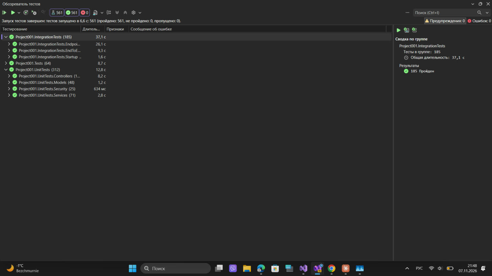

# Project001.IntegrationTests

Интеграционные тесты (xUnit + WebApplicationFactory) для [Project001](https://github.com/nikita139584/Project001).

## Запуск
Положите оба репозитория рядом:
```
папка/
├── Project001/              (или Project001-main)
└── Project001.IntegrationTests/
```
Затем: `dotnet test Project001.IntegrationTests` или откройте `Project001.IntegrationTests.csproj` в Visual Studio → Тест → Обозреватель тестов → Запустить все.

Firebase и интернет не нужны.

## Результат запуска


